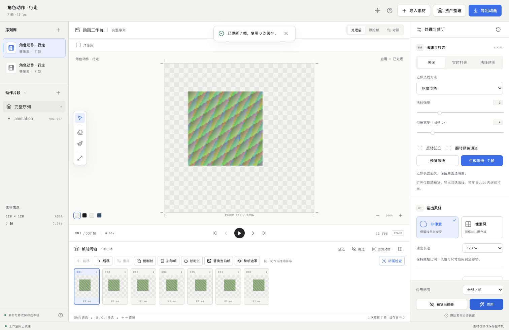

# AI 视频到游戏序列帧 · Frame Studio

将已有视频或图片序列整理成 **2D 游戏动画资产**：抽帧、抠图、逐帧修订、动作划分、风格处理，最后导出透明帧、Sprite Sheet 和 Godot 4 动画资源。

适用于角色动作、技能特效、道具动画等制作场景。你可以从外部 AI 工具生成的视频开始，也可以直接导入绘制或渲染好的图片序列，在同一个工作台完成预览、修订与交付。

[快速开始](#快速开始) · [制作流程](#制作流程) · [Godot 导出](#导出到-godot) · [详细使用指南](docs/usage.md)

## 界面预览



界面支持浅色、深色和跟随系统。[查看深色界面](docs/interface-dark.png) · [查看素材导入界面](docs/interface-empty.png)

## 核心功能

| 环节 | 功能 |
| --- | --- |
| 导入与抽帧 | 导入 MP4、MOV、WebM 或 PNG、JPG、WebP 序列；指定视频片段和抽帧率，图片按文件名自然排序 |
| 背景处理 | 保留透明度、色键抠图、U2NetP 本地 AI 抠图；遮罩收缩／扩张、羽化、边缘清理 |
| 动画编辑 | 连续播放、逐帧查看、拖动排序、复制、删除、跳过、帧时长调整；按片段设置动作名称、FPS 和循环 |
| 局部精修 | 擦除／恢复画笔、前后帧洋葱皮；下载单帧外部编辑后，替换原始帧或覆盖成品帧 |
| 跨帧修订 | 双向光流跟踪手动画笔修订，预览传播前后与风险区域，勾选目标帧后应用 |
| 动画检查 | 检查相似帧、异常跳变和循环候选，结合对照预览选择合并、跳过或切为动作 |
| 风格与画布 | 像素／非像素处理、共用色板、描边、帧间颜色稳定；统一画布、锚点、主体对齐及手动偏移 |
| 法线与打光 | 从轮廓或亮度生成近似法线，在 WebGL 画布中实时调整灯光并播放动画 |
| 资产导出 | 独立 RGBA PNG、多页图集、配对法线、帧与动作元数据、Godot SpriteFrames 和预览工程 |

### 按帧修订，保留原始素材

支持对全部帧或选中帧应用处理。单帧编辑更新指定帧及必要的依赖邻帧；画布尺寸和共用色板等整段设置作用于整个序列。原始素材保留，处理结果单独保存，最近 12 次编辑可撤销。

遮罩传播先提供对照预览，再由你选择要应用的帧。移动预览灯光、查看洋葱皮不会重新处理颜色帧，便于边检查边修订。

### 两条风格处理路径

| | 非像素动画 | 像素动画 |
| --- | --- | --- |
| 画面处理 | 保留渐变与半透明，也可平滑、分层和描边 | 像素网格、采样、颜色量化和有序抖色 |
| 色板 | 保留原色或调整颜色 | 从序列提取或导入共用色板 |
| 引擎采样 | Linear | Nearest |

## 快速开始

### 环境准备

- **Python 3.11**
- **Node.js 20+** 与 npm
- 支持 Canvas 2D 和 WebGL 的现代浏览器，推荐 Chrome
- **Godot 4** 为可选依赖，仅在打开导出的预览工程时需要

开发环境为 macOS Apple Silicon；Godot 导出流程使用 4.7.2。其他系统的依赖和运行配置可参考[使用指南](docs/usage.md)。

### 安装与启动

```bash
git clone https://github.com/aukmiriaP/AI-VIDEO-TO-FRAME-ANIMATION.git frame-studio
```

进入克隆后的 `frame-studio` 目录，执行：

```bash
python3.11 -m venv .venv
.venv/bin/python -m pip install -r requirements.lock.txt

npm --prefix web ci
npm --prefix web run build

.venv/bin/python launch.py
```

浏览器会打开 **<http://127.0.0.1:8971>**。完成安装和构建后，macOS 也可双击根目录的 `启动帧序.command`。保留启动终端，按 `Ctrl+C` 停止服务；关闭浏览器后可以重新打开继续编辑。

点击 **「试用练习素材」** 可体验程序绘制的水母动画，或点击 **「导入素材」** 开始自己的项目。

### AI 模型与本地数据

AI 抠图使用 **U2NetP / CPU**，首次在界面点击「下载抠图模型」联网下载，之后可本地运行。保留原 Alpha、色键抠图、逐帧编辑和导出不需要该模型，也不需要云端 API 密钥。

| 内容 | 默认位置 |
| --- | --- |
| 项目、原始素材、处理结果与导出 | `data/projects/` |
| 抠图模型 | `data/models/` |

可以通过环境变量 `FRAME_STUDIO_DATA` 指定其他数据目录。备份项目时复制对应的完整项目文件夹。素材、模型权重、依赖与缓存由 `.gitignore` 排除，不随源码仓库分发。

## 制作流程

**导入素材 → 处理背景 → 修订与划分动作 → 整理画布 → 导出到引擎**

1. **导入。** 选择视频或多张图片，设置抽帧率和输出风格。图片序列需保持相同尺寸，按文件名中的数字顺序排列。
2. **处理背景。** 透明图片选「保留」，纯色背景选「色键」，其他背景可使用「AI 抠图」。先「预览当前帧」，确认后「应用」。
3. **编辑动作。** 调整帧顺序、时长和启用状态，将连续范围「切为动作」，分别设置名称、播放速度和循环。
4. **修订细节。** 使用画笔配合洋葱皮检查轮廓；将已保存笔迹传播到邻帧，或下载单帧精修后替换。每次应用后都可撤销。
5. **整理资产。** 统一画布和锚点，选择保留原位置、边界居中或底部对齐。按需要生成法线并实时打光。
6. **导出。** 设置动作范围、图集列数、留白、扩边和文件名前缀，导出并下载 ZIP。

键盘操作：`← / →` 逐帧、`空格` 播放／暂停、`Shift` 连选、`⌘ / Ctrl` 多选。

参数预览用于检查效果，导出使用已应用的结果。完整参数说明、遮罩传播和单帧替换操作见[使用指南](docs/usage.md)。

## 导出到 Godot

导出 ZIP 包含：

```text
frames/              独立 RGBA PNG 帧
normals/             可选：独立法线 PNG
atlas-00.png         颜色图集，支持多页、留白与扩边
normal-atlas-00.png  可选：与颜色图集配对的法线图集
manifest.json       帧矩形、时长、动作、画布、锚点和处理参数
animations.tres     Godot SpriteFrames 动画资源
preview.tscn        动画预览场景
project.godot       独立 Godot 4 预览工程
README.txt          导入说明
```

**独立预览：** 解压 ZIP，在 Godot 4 中导入 `project.godot`，运行预览场景。

**用于已有游戏：** 将图集、`animations.tres` 和 `preview.tscn` 放进游戏工程的同一资产目录，实例化预览场景或在 `AnimatedSprite2D` 中加载资源。`project.godot` 只用于独立预览，复制到已有工程时应排除它。

导出的场景包含对应采样方式与锚点偏移。自行创建节点时，像素动画选择 Nearest，非像素动画选择 Linear，并根据 `manifest.json` 设置锚点。PNG 使用直通 Alpha，配对颜色和法线图集使用相同布局。

## 开发

前端使用 **React 19、TypeScript、Vite、Canvas 2D、WebGL**；后端使用 **FastAPI、Pillow、NumPy、OpenCV、PyAV、rembg / ONNX Runtime**。

完成依赖安装后，在仓库根目录启动后端：

```bash
.venv/bin/python -m uvicorn server.app:app --host 127.0.0.1 --port 8971
```

在另一个终端的仓库根目录启动前端：

```bash
npm --prefix web run dev
```

开发页面为 **<http://127.0.0.1:5178>**，Vite 将 API 和媒体请求转发到本地后端。

### 代码导航

| 位置 | 职责 |
| --- | --- |
| [`web/src/`](web/src/) | 编辑器、画布、时间轴、对照窗口与 WebGL 打光 |
| [`server/pipeline.py`](server/pipeline.py) | 视频与图片导入、分阶段渲染、缓存和局部依赖更新 |
| [`server/imaging.py`](server/imaging.py) / [`styling.py`](server/styling.py) | 抠图、Alpha 处理、风格、色板和帧间稳定 |
| [`server/editing.py`](server/editing.py) / [`replacing.py`](server/replacing.py) | 帧与动作编辑、单帧替换 |
| [`server/propagation.py`](server/propagation.py) / [`analysis.py`](server/analysis.py) | 遮罩传播、相似帧与循环检查 |
| [`server/normals.py`](server/normals.py) / [`exporting.py`](server/exporting.py) | 近似法线、图集及 Godot 资源生成 |
| [`server/app.py`](server/app.py) / [`storage.py`](server/storage.py) | API、后台任务、本地项目和撤销快照 |
| [`tests/`](tests/) | 后端测试、浏览器流程与 Godot 资源检查 |

### 检查

```bash
# 后端测试使用独立临时数据
.venv/bin/python -m pytest -q

# 前端类型检查与生产构建
npm --prefix web run build
```

浏览器与 Godot 检查的复现方式见[验证记录](docs/validation.md)。

## 项目说明

当前版本 **0.7**，输入为已有视频或图片，视频生成服务由外部工具提供。单序列最多 480 帧，单次导入最多 512 MB，单帧最多 1600 万像素。

动画检查与光流传播用于辅助筛选和修订，生成素材仍需人工确认。像素处理采用采样与量化；法线来自轮廓／亮度高度场近似。算法说明与处理参数见[使用指南](docs/usage.md)。

## 相关项目

- [rembg](https://github.com/danielgatis/rembg)：本地背景去除与模型推理。
- [U²-Net](https://github.com/xuebinqin/U-2-Net)：U2NetP 抠图模型。
- [Godot SpriteFrames](https://docs.godotengine.org/en/stable/classes/class_spriteframes.html)：序列帧动画资源。

模型、依赖与导入素材的许可分别遵循其来源条款。
