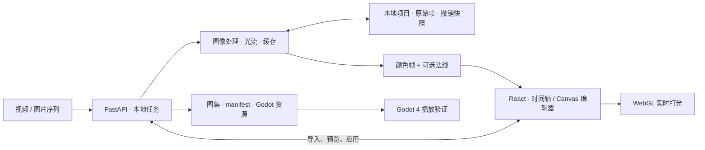

# AI 视频到游戏序列帧

一个面向 2D 游戏动画制作的本地编辑工具：将外部生成的 AI 视频或图片序列，整理为**可逐帧修订、可局部更新、可导入 Godot 的动画资产**。

当前为可运行的 **v0.7 本地原型**，已实现从导入、抠图、修帧到图集与引擎工程导出的流程。视频生成 API 尚未接入，素材需先从外部工具导出。

[快速运行](#快速运行) · [使用指南](docs/usage.md) · [验证记录](docs/validation.md)

## 为什么做这个项目

AI 视频可以提供动作参考，但距离游戏资产还有一段制作流程：需要去掉背景、检查异常帧、划分动作、统一画布与锚点，再导出符合引擎要求的纹理和播放数据。某一帧出现问题时，也需要保留已有工作，只修订受影响的部分。

本项目把这些步骤放进同一个编辑器。模型负责提供初始抠图结果，算法提供检查与传播候选，创作者通过预览、画笔和单帧替换决定最终结果。

## 界面预览


*截图使用半透明移动纹理作为回归测试素材，展示编辑器布局，不代表角色生成效果。支持浅色、深色和跟随系统。*

[查看深色界面](docs/interface-dark.png) · [查看导入界面](docs/interface-empty.png)

## 核心能力

| 制作环节 | 已实现能力 |
| --- | --- |
| 素材导入 | 视频按实际时间戳抽帧；图片序列自然排序；保留原始素材 |
| 背景与透明度 | 保留原 Alpha、色键抠图、U2NetP 本地 CPU 抠图；遮罩收缩／扩张、羽化与边缘清理 |
| 逐帧编辑 | 擦除／恢复画笔、洋葱皮、拖动排序、复制／删除／跳过、帧时长、动作片段与循环播放 |
| 局部精修 | 下载单帧后外部绘制，再替换原始帧或直接覆盖成品帧；支持撤销 |
| 跨帧修订 | 双向光流跟踪已保存的画笔修订；对比传播前后及风险区域，勾选目标后应用 |
| 动画检查 | 连续相似帧、异常跳变与循环候选；人工确认后合并、跳过或创建动作 |
| 风格与资产整理 | 非像素渐变处理、像素网格与共用色板；统一画布、锚点及主体对齐 |
| 法线与引擎导出 | 本地近似法线、WebGL 实时打光；RGBA PNG、图集、元数据及可运行的 Godot 4 预览工程 |

典型流程：

```text
外部生成视频／图片序列
  → 导入与抠图
  → 检查动作、修订单帧
  → 预览跨帧传播，确认目标后应用
  → 整理画布、锚点与输出风格
  → 导出图集，在 Godot 中检查播放效果
```

安装后可点击「试用练习素材」，无需准备外部视频即可体验流程。内置水母动画由程序绘制，也不代表 AI 生成或真实视频的抠图质量。

## 技术设计

### 局部更新与处理缓存

处理分为基础帧、邻帧颜色稳定、量化／抖色和法线等阶段。缓存键包含素材内容哈希、参数、画笔、画布、色板及邻帧依赖。

修改一帧后，只更新该帧及依赖它的必要邻帧；未受影响的结果继续复用。输出尺寸、共用色板等整段设置会影响整个序列。颜色稳定只读取邻帧的基础结果，不递归读取已滤波输出，避免修改沿全段扩散。

### 可检查、可撤销的修订

预览和动画检查不改变已保存项目。应用时校验项目 `revision` 与帧 ID，拒绝过期候选；项目通过临时文件替换原子写入，保留最近 12 次编辑快照。

跨帧传播使用 OpenCV 双向光流，并检查位置误差、外观变化、纹理和出画情况。跟踪丢失后停止该方向的后续应用。传播的是擦除／恢复意图，恢复取目标帧自己的像素；目标帧手动画笔优先，结果仍可独立修订。

### 图像处理与实时渲染分离

非像素路径使用预乘 Alpha 缩放以减少透明边缘黑边；像素路径先处理连续颜色，再统一量化到共用色板。像素化属于采样与量化，不会自动重画角色。

法线由 Alpha 距离场或亮度高度场近似生成，并独立缓存。移动灯光只更新浏览器 WebGL 着色器参数，不请求后端处理，也不把光照烘焙到颜色帧。

### 保留引擎所需的数据

颜色与法线图集共享帧矩形、留白和扩边；导出保留动作、逐帧时长、画布与锚点。Godot 预览工程通过 `SpriteFrames`、`AnimatedSprite2D` 和可选的 `CanvasTexture` 配对使用这些数据。



主要技术栈：React 19、TypeScript、Vite、Canvas 2D、WebGL、FastAPI、Pillow、NumPy、OpenCV、PyAV、rembg／ONNX Runtime。视频解码使用 PyAV；抠图模型为 U2NetP。光流与动画检查属于传统视觉算法，当前没有 LLM Agent 编排。

## 快速运行

已验证环境：**macOS arm64、Python 3.11、Node.js 20+、Chrome、Godot 4.7.2**。Godot 只在检查引擎导出时需要，编辑器本身不依赖它。其他平台尚未完成验证。

克隆仓库：

```bash
git clone https://github.com/aukmiriaP/AI-VIDEO-TO-FRAME-ANIMATION.git frame-studio
```

在克隆后的 `frame-studio` 目录执行以下命令：

```bash
python3.11 -m venv .venv
.venv/bin/python -m pip install -r requirements.lock.txt
npm --prefix web ci
npm --prefix web run build
.venv/bin/python launch.py
```

浏览器将打开 **http://127.0.0.1:8971**。依赖安装完成后，macOS 也可双击 `启动帧序.command` 启动。

AI 抠图需在界面中首次下载模型；模型下载后可本地运行，无需云端 API 密钥。色键、透明 PNG 编辑和练习素材不需要该模型。项目默认保存在 `data/projects/`，模型保存在 `data/models/`；这些内容、依赖和缓存均不包含在 Git 仓库中。

`requirements.lock.txt` 固定已验证环境的依赖版本，`requirements.txt` 提供直接依赖范围。可通过环境变量 `FRAME_STUDIO_DATA` 指定独立数据目录。

开发模式：在仓库根目录运行 `.venv/bin/python -m uvicorn server.app:app --host 127.0.0.1 --port 8971`，另一个终端运行 `npm --prefix web run dev`，访问 Vite 提供的本地地址。

## 验证与复现

```bash
# 仓库根目录；后端测试使用独立临时数据
.venv/bin/python -m pytest -q

# 前端类型检查与生产构建
npm --prefix web run build
```

截至 2026-11-08，**51 项后端测试及前端构建通过**；Chrome 已验证导入、画笔、传播候选、局部应用、撤销、主题切换及导出，Godot 已验证图集与法线配对、时长、锚点和实际换帧。

测试覆盖工程正确性，例如预览不落盘、过期候选拒绝、未受影响帧保持、替换尺寸校验与导出数据一致。主要使用构造的移动、半透明和遮挡素材；这些结果不能直接代表真实 AI 视频上的跟踪准确率或美术质量。具体用例与浏览器脚本复现条件见[验证记录](docs/validation.md)。

## 代码导航

| 位置 | 职责 |
| --- | --- |
| [`web/src/`](web/src/) | 编辑器、时间轴、画布交互、对照窗口与 WebGL 打光 |
| [`server/pipeline.py`](server/pipeline.py) | 导入、分阶段渲染、缓存与局部依赖更新 |
| [`server/imaging.py`](server/imaging.py) / [`styling.py`](server/styling.py) | 抠图、Alpha 处理、风格、色板与帧间稳定 |
| [`server/propagation.py`](server/propagation.py) / [`analysis.py`](server/analysis.py) | 遮罩传播与只读动画检查 |
| [`server/editing.py`](server/editing.py) / [`replacing.py`](server/replacing.py) | 动作与帧编辑、单帧替换及撤销协作 |
| [`server/normals.py`](server/normals.py) / [`exporting.py`](server/exporting.py) | 近似法线、图集与 Godot 资源生成 |
| [`server/app.py`](server/app.py) / [`storage.py`](server/storage.py) | API、后台任务、本地持久化与快照 |
| [`tests/`](tests/) | 后端回归、Chrome 流程检查与 Godot 验证脚本 |

## 当前限制与下一步

- **素材质量仍需人工判断。** 轻量抠图对发丝、模糊和背景近色可能失效；快速运动、肢体交叉或低纹理会影响光流。工具不修复视频中不存在的细节、错误肢体或形体漂移。
- **检查结果是候选。** 相似度与传播置信度不是经标定的质量概率；颜色稳定不等于轮廓稳定，循环播放不等于自动修复首尾接缝。
- **法线是视觉近似。** 不包含真实几何、投影阴影或完整 PBR 材质；亮度法可能将原图阴影解释为起伏。
- **当前是单机原型。** 每个序列最多 480 帧、单次导入最多 512 MB；暂不支持多人协作、重做、缓存清理 UI、原生桌面安装包及 Unity 专用导出。

后续优先完成一个真实角色的制作案例，记录失败样本、局部修订耗时和引擎播放效果，再评估更强的视频分割、主体锚点跟踪与生成服务接入。3D 场景结合 2D 角色的可玩 Demo 属于后续应用目标，当前仓库交付的是动画资产编辑与导出工具。
